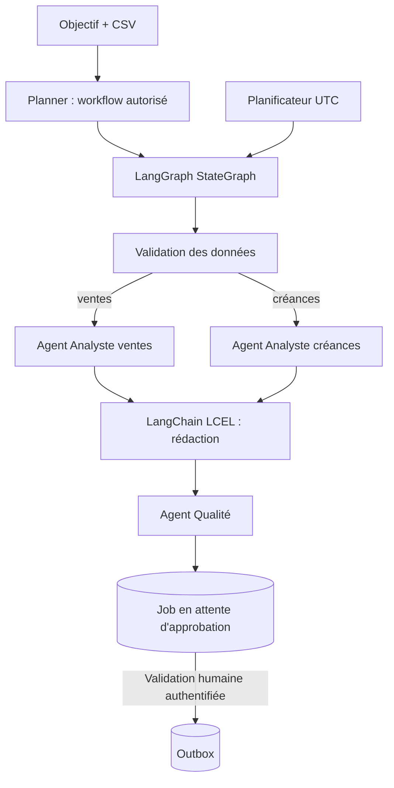

# AfriFlow Agents

**Agents spécialisés et automatisations métier | LangGraph · LangChain LCEL · FastAPI · Pandas · SQLAlchemy · Docker · PostgreSQL | Hébergement privé, Azure et AWS**

[Architecture](docs/ARCHITECTURE.md) · [Serveur d'entreprise](docs/ON_PREMISE.md) · [Sécurité](docs/SECURITY.md) · [Azure](docs/CLOUD_AZURE.md) · [AWS](docs/CLOUD_AWS.md)

## 1. Pourquoi AfriFlow Agents ?

De nombreuses PME consacrent encore du temps à consolider des tableaux de ventes, préparer des rapports, vérifier les créances et relancer les équipes. Ces tâches doivent être automatisables **sans** donner à un agent IA le droit d'envoyer librement des messages, d'exécuter des commandes arbitraires ou d'approuver ses propres résultats.

**AfriFlow Agents** orchestre une chaîne d'agents métier avec une séparation claire des responsabilités : validation, analyse des chiffres, rédaction, contrôle qualité et approbation humaine. Un ordonnanceur permet de répéter un workflow à échéance. Les cas de démonstration utilisent des données fictives en français et des montants en FCFA.

**Pour un particulier ou un indépendant :** préparer un suivi simple de ventes, calculer des indicateurs, constituer un rapport ou des brouillons de relance à valider avant utilisation.

**Pour une entreprise :** démontrer comment industrialiser des opérations récurrentes (reporting commercial, créances, routines de suivi) avec une traçabilité des traitements, une boîte d'envoi de livrables validés, une préparation à la planification et une séparation entre IA et décision humaine.

**Positionnement :** socle technique exploitable en démonstration et à étendre pour la production. Il n'est pas un ERP, ne vérifie pas le paiement réel d'une facture, ne lit pas automatiquement les e-mails et n'envoie aucun WhatsApp ou e-mail.

## 2. Architecture LangGraph et LangChain

**LangGraph** exécute un graphe d'état explicite avec embranchement `sales_report` ou `invoice_followup`. Le pipeline passe par `validate → analyse spécialisée → write → quality → queue_for_approval`. La reprise et l'approbation sont gérées par le référentiel SQL de l'application, **pas par un checkpointer LangGraph** ; le graphe traite une exécution à la fois.

**LangChain Core / LCEL** (`RunnableLambda`) encapsule la génération reproductible des rapports commerciaux, pour une composition future avec d'autres composants autorisés. La planification du type de workflow reste bornée à une liste blanche et peut utiliser un LLM facultatif.



## 3. Deux workflows opérationnels

| Workflow | Entrée | Travail effectué | Résultat |
|---|---|---|---|
| `sales_report` | CSV : `date,produit,region,quantite,prix_fcfa` | Calculs du CA, synthèses par produit et région, rédaction et vérification de structure | Rapport commercial prêt pour relecture |
| `invoice_followup` | CSV : `client,montant_fcfa,echeance` | Repérage des échéances dépassées, préparation de messages prudents | Brouillons à vérifier avec le service comptable |

Un job n'est ajouté à l'**outbox** qu'après un appel authentifié à `POST /v1/jobs/{id}/approve`. L'outbox n'est **pas un service d'envoi**. Le worker planifie de nouvelles exécutions mais n'approuve rien automatiquement.

## 4. Installer et lancer en local

Prérequis : Python 3.11+, Git.

```bash
git clone <URL_DE_VOTRE_DEPOT>
cd afriflow-agents
python -m venv .venv
source .venv/bin/activate              # Windows : .\.venv\Scripts\Activate.ps1
pip install -e ".[dev]"               # inclut LangGraph et LangChain Core
cp .env.example .env                  # Windows : Copy-Item .env.example .env
# Remplacer APP_API_KEY par un secret aléatoire de 32 caractères ou plus.
python scripts/seed_demo.py
uvicorn app.api:app --env-file .env --host 127.0.0.1 --port 8000
```

Interface Web : `http://127.0.0.1:8000/` · API Swagger : `http://127.0.0.1:8000/docs`.

Le worker local, dans un second terminal :

```bash
python -m app.worker
```

Docker local :

```bash
cp .env.example .env
docker compose up -d --build
```

### Exemple API

```bash
export KEY="<VOTRE_APP_API_KEY>"
DATASET_ID=$(curl -s -X POST http://127.0.0.1:8000/v1/datasets \
 -H "X-API-Key: $KEY" -H "Content-Type: application/json" \
 -d '{"name":"ventes.csv","csv_text":"date,produit,region,quantite,prix_fcfa\n2026-11-01,Riz,Abidjan,2,1500\n"}' \
 | python -c 'import json,sys;print(json.load(sys.stdin)["id"])')

curl -X POST http://127.0.0.1:8000/v1/agents/run \
 -H "X-API-Key: $KEY" -H "Content-Type: application/json" \
 -d "{\"goal\":\"Analyse les ventes par région\",\"dataset_id\":\"$DATASET_ID\"}"
```

La réponse contient un `job.id` et un statut `pending_approval`. Vous pouvez consulter `GET /v1/jobs`, puis **approuver manuellement** via `POST /v1/jobs/{id}/approve`, avant de consulter `GET /v1/outbox`.

## 5. Installer sur un serveur privé de l'entreprise

Une entreprise peut héberger l'application sur sa VM, son VPS ou son cluster de conteneurs, sans dépendre d'un cloud public. Le déploiement d'exemple `compose.enterprise.yaml` comprend PostgreSQL, l'API, **un seul worker** et un service de modèle local optionnel (Ollama). La base et le modèle ne publient pas de ports publics. L'API est attachée au loopback de l'hôte sur **8001** par défaut, afin de cohabiter avec AfriDoc.

```bash
cp .env.enterprise.example .env.enterprise
# Modifier APP_API_KEY, POSTGRES_PASSWORD et DATABASE_URL.
docker compose --env-file .env.enterprise -f compose.enterprise.yaml up -d --build
```

Le mode sans modèle est déterministe et ne requiert aucun fournisseur externe (`LLM_PROVIDER=off`). Le mode privé autorise l'inférence sur un serveur local compatible OpenAI, avec une étape d'installation de modèle :

```bash
# Dans .env.enterprise : LLM_PROVIDER=local
docker compose --env-file .env.enterprise -f compose.enterprise.yaml --profile local-llm up -d --build
docker compose --env-file .env.enterprise -f compose.enterprise.yaml exec ollama ollama pull qwen2.5:3b
```

Le téléchargement initial du modèle demande généralement Internet ; l'inférence peut rester interne ensuite avec une politique réseau correcte. Vérifier le matériel, le temps de réponse et les performances métiers du modèle. Voir le [guide on-premise](docs/ON_PREMISE.md).

## 6. Configuration de l'inférence

| Paramètre | Utilité |
|---|---|
| `LLM_PROVIDER=off` | Aucune requête de génération externe ou locale ; traitements déterministes |
| `LLM_PROVIDER=groq` + `GROQ_API_KEY` | Rédaction optionnelle via fournisseur hébergé |
| `LLM_PROVIDER=local` | Utiliser le serveur de modèle OpenAI-compatible de l'entreprise |
| `LOCAL_LLM_BASE_URL` | URL configurée par l'administrateur, ex. `http://ollama:11434/v1` |
| `LOCAL_LLM_MODEL` | Modèle préalablement téléchargé et autorisé |
| `ENABLE_LLM_PLANNER=true` | Classification optionnelle de l'objectif par le modèle, restreinte aux deux workflows |

Le commentaire de rapport est transmis au LLM sur **agrégats** ; il ne faut pas en déduire qu'un déploiement est conforme à une politique de protection des données sans analyse supplémentaire. En mode `off`, aucun appel vers un LLM n'est effectué.

## 7. API, tests et sécurité

Principaux endpoints : `POST /v1/datasets`, `POST /v1/agents/plan`, `POST /v1/agents/run`, `POST /v1/jobs`, `GET /v1/jobs`, `POST /v1/jobs/{id}/approve`, `GET /v1/outbox`, `POST /v1/schedules`, `POST /v1/scheduler/tick`, `GET /v1/audit`.

```bash
pytest -q
```

Tests unitaires et API : règles de calcul, contrôle CSV, échéances, authentification, approbation idempotente et planification. Pour la production : SSO et permissions, file de tâches durable avec reprises, surveillance, sauvegardes restaurables, authentification des connecteurs externes et évaluation métier sur des données autorisées.

**Limites connues :** pas de reprise transactionnelle distribuée LangGraph, pas d'envoi de messages, contrôle qualité basé sur des règles, absence de RBAC/SSO, sécurité non auditée indépendamment. Ne pas utiliser sur des données financières sensibles sans les contrôles de l'organisation.

## 8. Stack

`Python` · `FastAPI` · `LangGraph StateGraph` · `LangChain Core / LCEL` · `Pandas` · `SQLAlchemy` · `SQLite / PostgreSQL` · `Docker` · `Pytest` · `GitHub Actions` · `Ollama ou Groq (optionnels)` · `Azure Container Apps` · `AWS App Runner`.

**English summary:** Auditable multi-agent business automation for French-speaking SMEs. LangGraph state machine, LangChain LCEL writer, deterministic data processing, persistent human approvals, UTC schedule worker, and optional private or hosted inference. Enterprise deployment examples included; production identity, permissions and reliable distributed workers must be added before sensitive use.

## Licence

MIT — [LICENSE](LICENSE).
